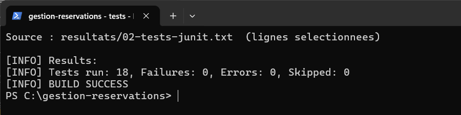
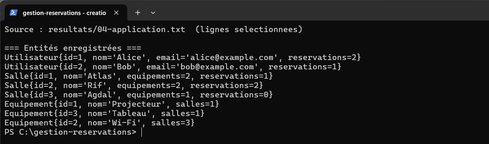
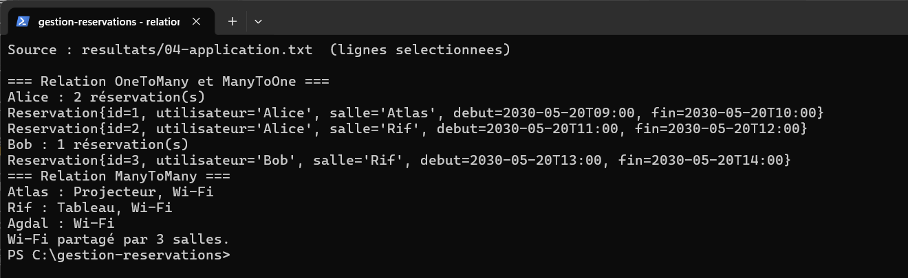
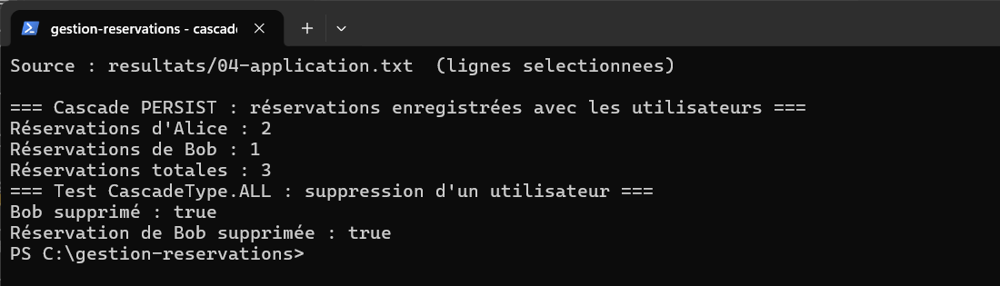
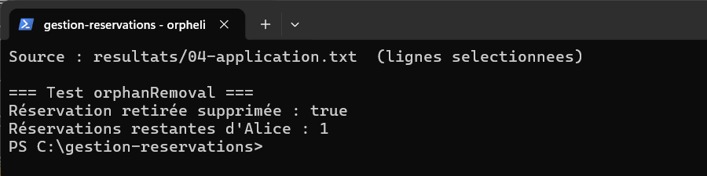
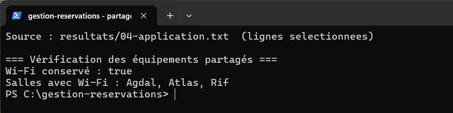
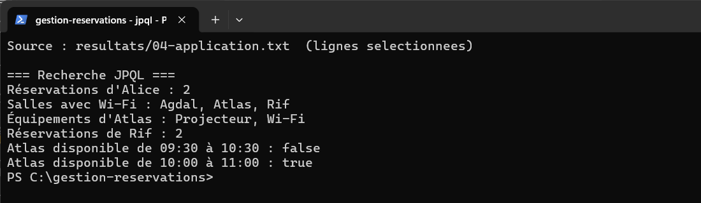
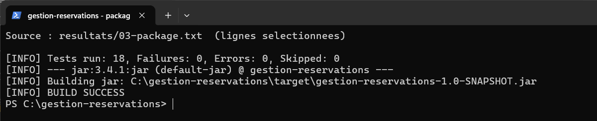

# Lab 3 – Gestion des réservations avec JPA et Hibernate

## Objectif

Ce TP consiste à gérer des utilisateurs, des salles, des réservations et des équipements dans une application Java. Il permet de pratiquer les relations JPA, les cascades et les recherches JPQL.

## Technologies utilisées

Java 11 (exécuté avec JDK 17), Maven, JPA 2.2, Hibernate Core 5.4.30.Final, H2 1.4.200 et JUnit 4.13.2.

## Travail réalisé

- Relations OneToMany, ManyToOne et ManyToMany, avec un équipement partagé entre plusieurs salles.
- Persistance et suppression en cascade des réservations ; suppression orpheline avec `orphanRemoval`.
- Recherches JPQL et vérification des chevauchements de réservations. Deux créneaux adjacents restent disponibles.
- Transactions avec rollback et 18 tests JUnit indépendants.

## Exécution

Dans PowerShell, depuis le dossier du projet :

```powershell
$env:JAVA_HOME = 'C:\Program Files\Eclipse Adoptium\jdk-17.0.16.8-hotspot'
$env:Path = "$env:JAVA_HOME\bin;$env:Path"
mvn clean compile
mvn clean test
mvn clean package
mvn compile exec:java "-Dexec.mainClass=com.example.App"
```

Dans IntelliJ IDEA, sélectionner le JDK 17 et lancer `com.example.App`.

## Résultats

| Vérification | Résultat réel |
| --- | --- |
| Compilation | `BUILD SUCCESS` |
| Tests JUnit | 18 réussis, 0 échec, 0 erreur |
| Exécution de `App` | `BUILD SUCCESS` |
| Package Maven | `BUILD SUCCESS` ; JAR créé |

Les sorties complètes, dont les requêtes SQL, sont dans [`resultats/`](resultats/). Les images suivantes sont de vraies captures d'une fenêtre PowerShell affichant des lignes de ces journaux.

## Captures d'écran

**1. Tests JUnit.**



**2. Création des utilisateurs, salles et équipements.**



**3. Relations JPA.**



**4. Cascades de persistance et de suppression.**



**5. Suppression orpheline.**



**6. Équipements partagés conservés.**



**7. Recherches JPQL et disponibilité.**



**8. Package Maven.**



## Conclusion

J'ai appris à relier plusieurs entités JPA et à utiliser les cascades pour gérer leurs données. Les tests confirment que les réservations, les recherches et les suppressions fonctionnent.
